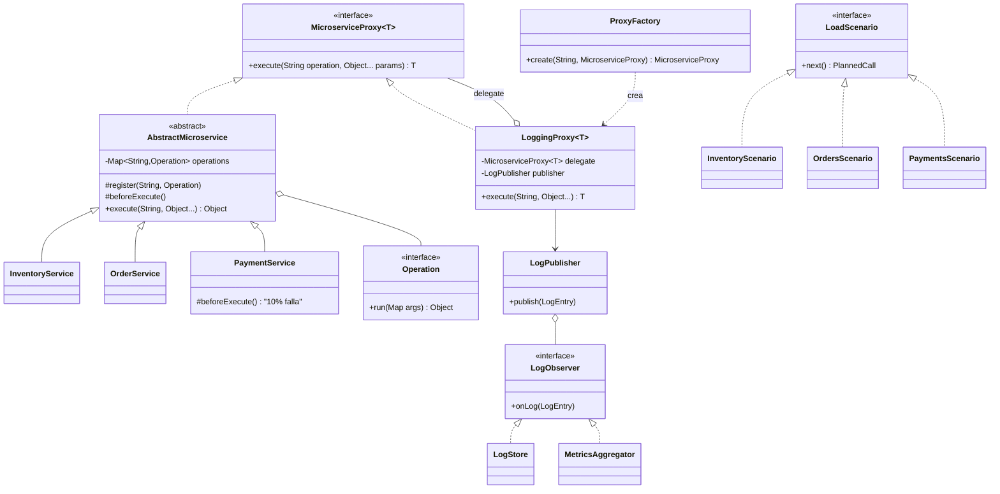

# Patrones de diseño aplicados en el backend

| Patrón | Dónde | Para qué |
|---|---|---|
| **Proxy** (estructural) | `MicroserviceProxy<T>` + `LoggingProxy<T>` | El proxy comparte la interfaz del servicio real, lo envuelve y audita cada llamada (inicio, duración, resultado, error) sin que el servicio lo sepa. Es el patrón central del taller. |
| **Template Method** (comportamiento) | `AbstractMicroservice.execute()` | Fija el algoritmo (hook previo → resolver operación → ejecutar). `PaymentService` solo sobreescribe `beforeExecute()` para inyectar latencia y el 10 % de fallos. |
| **Command** (comportamiento) | `Operation` | Cada operación (`getStock`, `charge`, …) es un objeto registrado por nombre. Reemplaza los `switch`; agregar una operación no modifica el código existente (Open/Closed). |
| **Observer** (comportamiento) | `LogPublisher` → `LogObserver` (`LogStore`, `MetricsAggregator`) | El proxy publica un `LogEntry` y cada observador reacciona (guardar logs, acumular métricas). Suscribir uno nuevo no toca al proxy. |
| **Factory** (creación) | `ProxyFactory` | Único lugar que sabe armar un `LoggingProxy` para cualquier servicio. |
| **Strategy** (comportamiento) | `LoadScenario` (`InventoryScenario`, `OrdersScenario`, `PaymentsScenario`) | Cada servicio define cómo generar sus llamadas de `simulate-load`; `LoadSimulator` elige una estrategia al azar. |
| **Registry** | `ProxyRegistry` | Resuelve `{service}` de la URL al proxy correcto. |
| **Singleton + Inyección de dependencias** | Beans de Spring (`@Service`, `@Component`) | Una sola instancia de cada servicio, almacén y fábrica, conectadas por constructor. |

## Diagrama de clases

## Flujo de una llamada
`POST /api/services/payments/charge` → `ServiceController` → `ProxyRegistry` → `LoggingProxy` (crea `requestId`, mide tiempo) → `PaymentService.execute` (Template Method: `beforeExecute` → `Operation charge`) → resultado o excepción → `LogPublisher` notifica a `LogStore` y `MetricsAggregator`.
